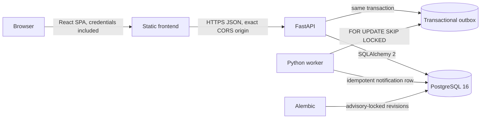

# Architecture

## Runtime structure

- `frontend/src/`: React/TypeScript single-page application, Vite build, API client, and views.
- `frontend/tests/`: React integration tests against a real FastAPI process and a dedicated PostgreSQL test database.
- `backend/app/main.py`: FastAPI application, CORS, security headers, and health endpoint.
- `backend/app/api/`: auth, dashboard, team, and work-item routes.
- `backend/app/models.py`, `schemas.py`, `database.py`: SQLAlchemy models, strict Pydantic request/response shapes, engine/session management.
- `backend/app/security.py`, `authz.py`: opaque session/cookie primitives and database-derived team roles.
- `backend/app/worker/`: leased outbox worker and idempotent notification handler.
- `backend/alembic/`: schema revisions and safe adoption logic for a recognized legacy schema.
- `docker-compose.yml`: local PostgreSQL, API, worker, and static frontend.

## Request and trust boundaries

The browser calls `/api/v1` with `credentials: "include"`. The API issues an opaque, random session token in an HttpOnly cookie and stores only its HMAC-SHA256 hash. The CSRF endpoint returns a token to the frontend and stores the corresponding cookie; all state-changing requests must include the token in `X-CSRF-Token`. Production requires secure cookies, a session secret of at least 32 characters, and exact HTTPS CORS origins.

Request data is validated by Pydantic. Authorization reads membership and role from PostgreSQL for each operation. A non-member cannot use UI visibility or client-supplied team/actor fields to bypass server checks. Errors use a stable `{ "error": { "code", "message", "details?" } }` envelope.

## Transactions and concurrency

| Operation | Atomic database work |
|---|---|
| Create item | idempotency key/hash, item, `CREATED` activity, outbox job, replay response |
| Edit item | version predicate, changed fields, activity records |
| Claim item | conditional unassigned-row update, version increment, `CLAIMED` activity |
| Transition/approval | allowed-edge and role checks, version predicate, status update, activity, outbox |
| Add comment | comment and `COMMENTED` activity |

Optimistic edits carry `expectedVersion`; stale requests return `409 STALE_VERSION`. Claim uses a conditional SQL update so simultaneous claimants cannot both win. Activity changes commit with the business mutation and a PostgreSQL trigger prevents activity updates/deletes.

## Worker and migration behavior

The API inserts outbox work in the same transaction as the triggering state change. The worker leases due rows using `FOR UPDATE SKIP LOCKED`, retries with bounded exponential backoff, redacts stored error text, and deduplicates its database notification by unique job ID. Delivery is at-least-once, not exactly-once. The current notification handler persists an in-app notification row; no email provider is configured.

Alembic applies versioned schema changes. A PostgreSQL advisory lock serializes upgrades. Fresh databases receive the current schema; recognized legacy schemas can be adopted without dropping existing tables. Unrecognized or partial schemas are rejected rather than reset.

## Data-access performance

Item lists use bounded keyset pagination over descending IDs; query filters and search run in PostgreSQL. Dashboard values are SQL aggregates scoped to the current user's teams. PostgreSQL is the source of truth for users, memberships, items, activity, sessions, idempotency, outbox, and notifications.
