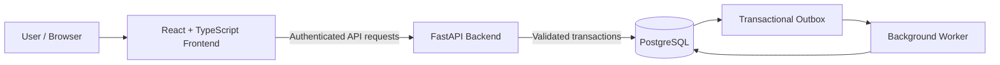

# Newtonite Ops — Operations Under Pressure

**A secure, full-stack operational work management platform built for teams working under pressure.**

Newtonite Ops brings work items, ownership, collaboration, approvals, and operational history into one place. It replaces scattered chats, spreadsheets, and email threads with structured workflows, accountable ownership, and reliable state changes.

## Overview

Newtonite Ops helps teams create, assign, investigate, discuss, approve, and resolve operational work through a centralized application.

The platform is designed around clear permissions, concurrency-safe updates, traceable activity, and a responsive command-center interface.

## Features

### Work Management
- Create, search, filter, sort, and paginate work items.
- Claim unassigned work and assign or reassign items according to permissions.
- Track status, priority, due dates, ownership, and team.
- Inspect work-item details, comments, and activity history.
- Identify blocked, overdue, urgent, and approval-pending work.

### Dashboard and Insights
- View work assigned to you.
- Identify unassigned urgent work.
- Review items awaiting your approval.
- Track blocked and overdue work.
- Explore status and priority distributions.
- Review recently updated work and operational activity.

### Workflow and Collaboration
- Support controlled work-item status transitions.
- Enforce lead-only approval and resolution actions.
- Add comments and preserve an activity timeline.
- Reject stale updates using optimistic concurrency checks.
- Prevent conflicting claims through server-side validation.
- Support idempotent creation to reduce duplicate submissions.

### Security and Reliability
- Server-side authentication and authorization.
- Secure cookie-based sessions and CSRF protection.
- Team-scoped access controls.
- Transactional database updates.
- PostgreSQL-backed notification outbox and worker.
- Safe database migrations and development-only seed data.

### User Experience
- Responsive command-center interface.
- Search and filtering for operational work.
- Accessible alternatives for interactive visualizations.
- Light and dark themes.
- Keyboard-accessible navigation and command palette, where implemented.

## Technology Stack

| Layer | Technology |
|---|---|
| Backend | Python 3.11+, FastAPI |
| Validation | Pydantic |
| ORM | SQLAlchemy 2 |
| Database | PostgreSQL 16 |
| Migrations | Alembic |
| Frontend | React, TypeScript, Vite |
| Styling | Tailwind CSS |
| Testing | pytest, HTTPX, frontend test tooling |
| Infrastructure | Docker, Docker Compose |
| Background processing | PostgreSQL-backed outbox worker |

## Architecture



The frontend communicates with the backend through an HTTP API. The backend validates permissions and workflow transitions before modifying persistent state. Database transactions preserve consistency, while the outbox worker processes queued notification jobs.

## Repository Structure

```text
newtonite-ops/
├── backend/
│   ├── app/
│   │   ├── api/
│   │   ├── worker/
│   │   ├── tests/
│   │   ├── main.py
│   │   ├── models.py
│   │   ├── schemas.py
│   │   ├── security.py
│   │   ├── authz.py
│   │   └── seed.py
│   ├── alembic/
│   ├── requirements.txt
│   └── .env.example
├── frontend/
│   ├── src/
│   ├── tests/
│   ├── package.json
│   └── .env.example
├── scripts/
├── docs/
├── docker-compose.yml
├── ARCHITECTURE.md
├── DESIGN.md
├── ENGINEERING_DECISIONS.md
├── KNOWN_LIMITATIONS.md
└── README.md
```

*Keep this structure synchronized with the actual files in the repository.*

## Prerequisites

Install the following before running the application:

- Python 3.11 or newer
- Node.js 20 or newer and npm
- Git
- Docker Desktop with the Linux container engine running
- Visual Studio Code (recommended)

Verify your installation:

```powershell
py --version
node --version
npm --version
git --version
docker --version
docker compose version
```

## Getting Started on Windows

### 1. Clone the repository

```powershell
git clone https://github.com/bhattsana/newtonite-ops.git
Set-Location .\newtonite-ops
code .
```

### 2. Start PostgreSQL

Start Docker Desktop and wait until its engine is ready.

From the repository root:

```powershell
docker compose up -d db
docker compose ps
```

Wait for PostgreSQL to become healthy before continuing.

### 3. Set up the backend

Open a new PowerShell terminal in VS Code:

```powershell
Set-Location .\backend
py -3.11 -m venv .venv
.\.venv\Scripts\Activate.ps1
python -m pip install -r requirements.txt
```

Create a local environment file if one does not already exist:

```powershell
if (-not (Test-Path .env)) {
    Copy-Item .env.example .env
}
```

Review `backend/.env` and configure the database URL and other required environment variables to match your Docker Compose configuration.

For local development, use the appropriate local settings, including an HTTP-compatible cookie configuration and the correct frontend origin.

### 4. Apply database migrations

With the virtual environment active and the terminal inside `backend/`:

```powershell
alembic upgrade head
```

Only seed a fresh development database:

```powershell
python -m app.seed
```

Do not reset an existing database or overwrite existing environment configuration to troubleshoot startup problems.

### 5. Start the backend API

From `backend/`, run:

```powershell
uvicorn app.main:app --reload --port 8000
```

The API should be available at:

- API: http://localhost:8000
- Health check: http://localhost:8000/healthz
- Interactive API documentation: http://localhost:8000/docs

These endpoints depend on the corresponding routes being implemented in the final application.

### 6. Start the frontend

Open another VS Code terminal:

```powershell
Set-Location .\frontend
npm ci
npm run dev
```

Open the Vite URL displayed in the terminal. For the default development configuration, this should be:

http://localhost:5173

The frontend's API configuration should point to the running backend. If using the Vite `/api` proxy, configure it to forward requests to `http://localhost:8000`.

### 7. Start the background worker

If the project includes the outbox worker, open another terminal:

```powershell
Set-Location .\backend
.\.venv\Scripts\Activate.ps1
python -m app.worker
```

Keep the worker running while testing notification processing.

## Application Workflow

A typical operational workflow is:

1. Create a work item.
2. Assign or claim ownership.
3. Investigate the issue and add comments.
4. Update the status as work progresses.
5. Submit the item for approval when required.
6. Allow an authorized lead to approve or request changes.
7. Resolve and close the item according to the configured workflow.
8. Review the activity history for traceability.

All workflow transitions and permissions must be validated by the backend rather than relying solely on frontend controls.

## Security Model

The intended security model includes:

- Authentication for protected operations.
- Server-side role and team-membership checks.
- Restricted approval and reassignment actions.
- CSRF protection for state-changing requests when cookie sessions are used.
- Optimistic concurrency checks to prevent silent overwrites.
- Idempotency support for safe retries.
- Environment-based configuration for secrets and database credentials.

Never commit real `.env` files, production credentials, session secrets, or API keys. Use `.env.example` files with safe placeholder values.

## Testing

Run the test commands supported by the final repository.

Backend tests, from `backend/` with the virtual environment active:

```powershell
python -m pytest -q
```

Frontend tests, from `frontend/`:

```powershell
npm test
```

Production frontend build, from `frontend/`:

```powershell
npm run build
```

If the repository provides a root-level test script, use the documented command to run the complete suite.

**Important:** Backend tests that recreate database tables must use a dedicated disposable test database. Never run destructive tests against production or a development database containing data you need.

## Configuration

Configuration is provided through environment files and Docker Compose.

Typical backend settings include:

- `DATABASE_URL`
- `ENVIRONMENT`
- `COOKIE_SECURE`
- `SESSION_HOURS`
- `CORS_ORIGINS`

Use the variable names and defaults defined in the actual `.env.example` files. Keep local configuration out of Git.

## Troubleshooting

**PostgreSQL does not start**

```powershell
docker compose ps
docker compose logs --tail 50 db
```

Check that Docker Desktop is running and that the configured database port is available.

**Backend dependency installation fails**

Confirm that Python 3.11 or newer is installed and that the backend virtual environment is active. Review the first dependency installation error.

**Frontend cannot reach the API**

Verify that the backend is running, that the Vite proxy or API base URL is correct, and that backend CORS settings match the configured frontend origin.

**Database migration fails**

Inspect the current database schema and migration history before attempting changes. Do not drop existing tables or remove persistent database volumes as a first troubleshooting step.

**Login fails**

Confirm that the account exists in the configured development database, that the seed process completed when appropriate, and that the frontend and backend use the expected session and CSRF configuration.

## Documentation

Refer to the following documents when present:

- `ARCHITECTURE.md` — system components and data flow
- `DESIGN.md` — interface principles and design system
- `ENGINEERING_DECISIONS.md` — important engineering trade-offs
- `KNOWN_LIMITATIONS.md` — outstanding limitations and verification status
- `docs/` — additional technical documentation and demo material

## Project Status

Newtonite Ops is intended to provide a reliable, permission-aware workspace for operational work management.

Before describing the project as production-ready, verify the actual implementation, run the relevant tests, review security configuration, and validate deployment behavior. Document any incomplete features and known limitations honestly.

## License

Add the license applicable to this project before redistributing it publicly.
