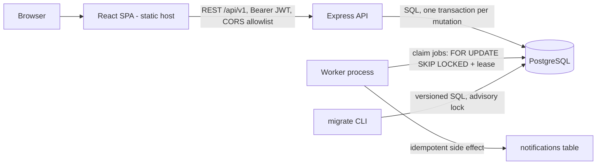

# Architecture

## Request pipeline
`security headers -> CORS allowlist -> JSON body (100 kB limit) -> route -> Zod validation -> auth (JWT verify, user + revocation lookup) -> resource access check -> transaction -> error handler`.
Errors always have the shape `{ error: { code, message, details? } }`: 400 bad JSON, 401 unauthenticated, 403 role too low, 404 not found OR not your team, 409 conflict (`STALE_VERSION`, `ALREADY_CLAIMED`, `INVALID_TRANSITION`, `IDEMPOTENCY_KEY_REUSED`), 413 body too large, 422 validation (unknown fields included), 429 throttled, 500 generic (no stack traces, no internals).

## Authentication and authorization
- Login verifies argon2id, issues a 15-minute HS256 JWT with a random `jti`. Every request re-reads the user and checks the `jti` is not in `revoked_tokens` (logout). Failed logins are counted per email+IP in `login_attempts`.
- Authorization is a single function, `access()`: it joins `memberships` for the caller and the item's team in the same query that loads the item. No membership -> 404 (existence is not revealed). Membership with too low a role -> 403. Roles come from the database on every request, never from the token or the client. Client-supplied team ids, assignee ids and actor ids are validated server-side; `actor` is always the token's user.

## Transaction boundaries (one PostgreSQL transaction each)
| Operation | In the same transaction |
|-|-|
| create item | membership check, idempotency record (if key), item insert, `CREATED` event, outbox job, stored replay response |
| edit (PATCH) | access check, `UPDATE … WHERE version=$expected`, one event per changed field. No change -> nothing written |
| claim | access check, `UPDATE … WHERE assignee_id IS NULL`, `CLAIMED` event |
| transition / approval | access + workflow check, `UPDATE … WHERE version=$expected`, `STATUS_CHANGED` / `APPROVED` / `APPROVAL_REJECTED` event, outbox job for AWAITING_APPROVAL and RESOLVED |
| comment | access check, comment insert, `COMMENTED` event |
Any error rolls the whole transaction back; tests inject a failure after the business write on each of these paths and assert nothing remains. `activity_events` rejects UPDATE and DELETE at the database level.

## Outbox worker
States: `PENDING -> PROCESSING -> DONE | FAILED`. A worker claims one due job with `FOR UPDATE SKIP LOCKED`, increments `attempts`, sets `locked_at` (the lease, 60 s default). Success -> DONE. A thrown error -> back to PENDING with `available_at = now + min(2^attempts, 300) s`, or FAILED when `attempts >= 5` or the handler threw `PermanentJobError`. A PROCESSING job whose lease expired (worker crashed) is claimed again; if it had already used all attempts it becomes FAILED. The lease is cleared whenever a job leaves PROCESSING. Stored and logged errors are truncated and stripped of URL credentials and `key=value` secrets. SIGTERM/SIGINT stop the loop after the current job. Delivery is at-least-once; the default handler is idempotent (unique `job_id`). A job longer than the lease could be delivered twice: keep handlers short or raise the lease.

## Migrations
`npm run migrate` applies `db/migrations/*.sql` in order, one transaction each, recorded in `schema_migrations`, under an advisory lock. It refuses (with a clear message) a database that has only part of the baseline schema or that records migrations this code does not know. A failing migration is rolled back whole and reported by file name.

## Pagination, filters, search
Keyset cursor on `id DESC` (stable, no deep-offset cost), `limit <= 100`, filters applied in SQL, search by `ILIKE` on title/description/reference. Dashboard counts are SQL aggregates over the caller's teams only.
